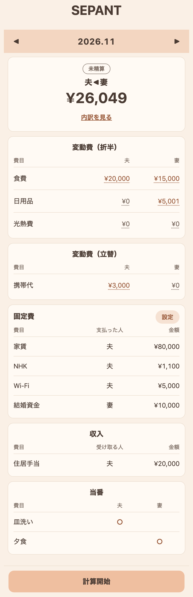
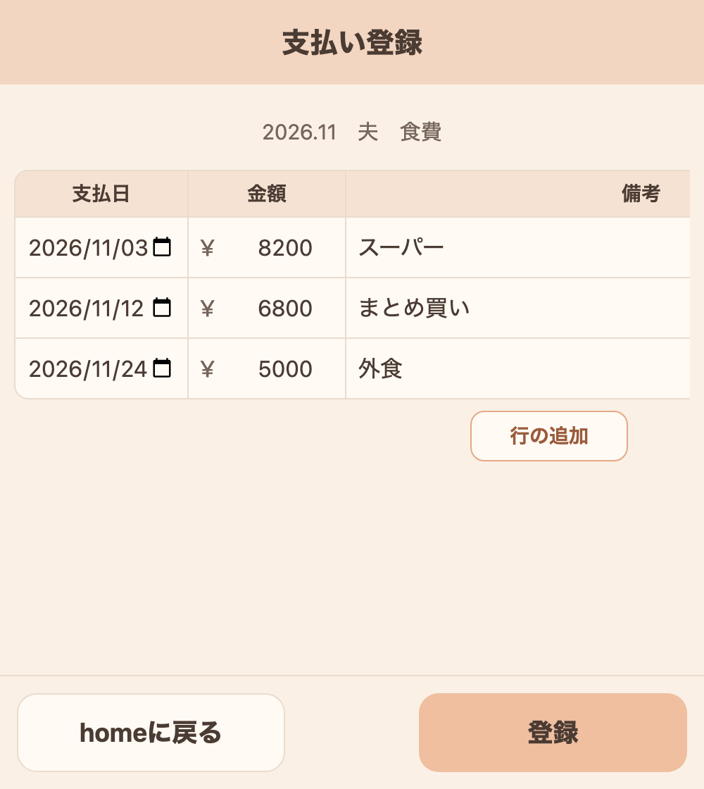
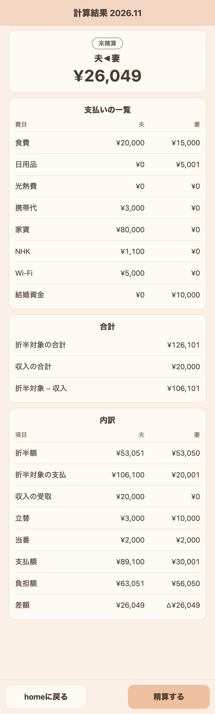
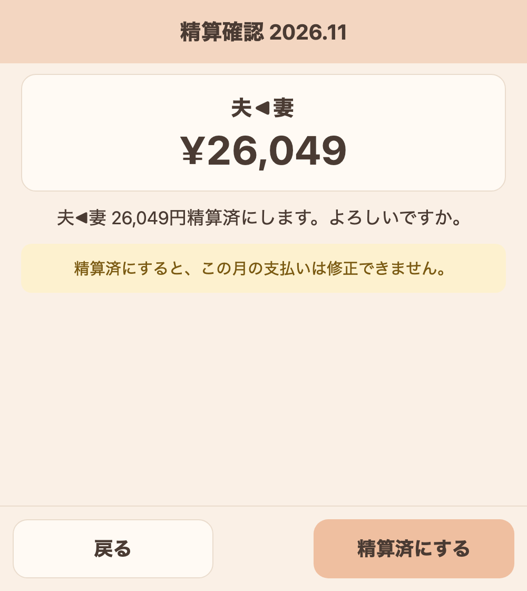
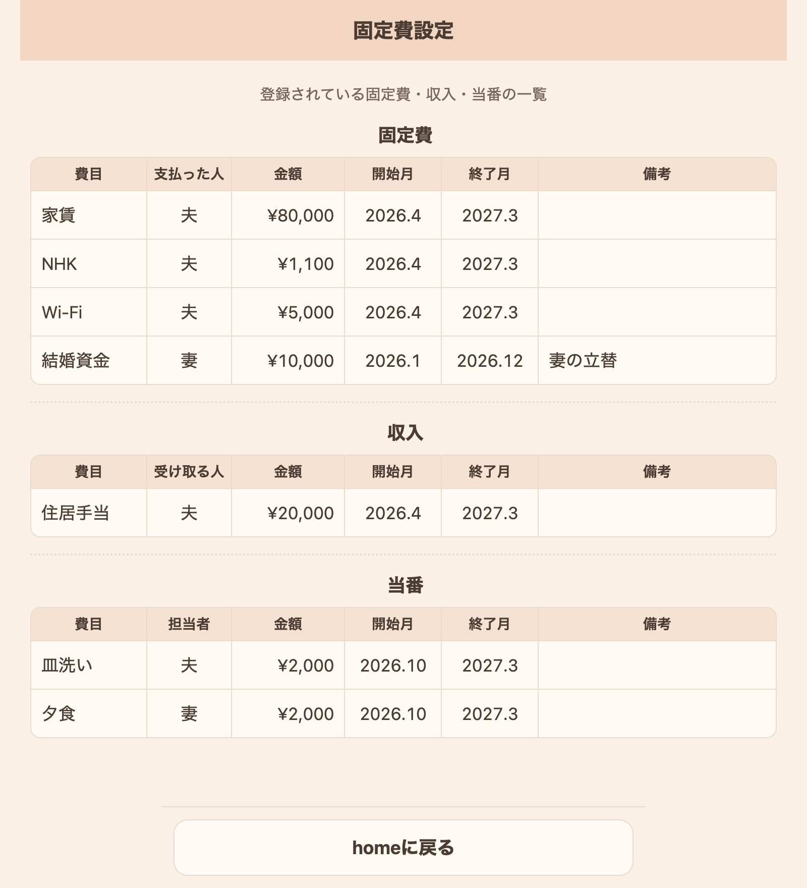

# SEPANT（折半額計算システム）

夫婦の生活費を折半する家計アプリ。毎月の支払いを入力すると、どちらがいくら払えば公平になるかを計算する。

## 画面

| ホーム | 支払い登録 | 計算結果 | 精算確認 |
|:---:|:---:|:---:|:---:|
|  |  |  |  |
| 当月の精算額と、費目ごとの支払いの一覧 | 金額をタップして、その費目の支払いを入力 | 精算額を出すまでの計算の内訳 | 精算済にすると、その月はロックされる |

**固定費設定**（固定費・収入・当番の一覧）



## 使用例（2026年11月）

上の画面は、次の内容を入力したときのものです。

| 区分 | 費目 | 夫 | 妻 |
|---|---|---:|---:|
| 折半（変動費） | 食費 | 20,000 | 15,000 |
| 折半（変動費） | 日用品 | | 5,001 |
| 折半（固定費） | 家賃・NHK・Wi-Fi | 86,100 | |
| 立替（変動費） | 携帯代（妻の分を夫が支払い） | 3,000 | |
| 立替（固定費） | 結婚資金（夫の分を妻が支払い） | | 10,000 |
| 収入 | 住居手当 | 20,000 | |
| 当番 | 皿洗い（夫）・夕食（妻） | 2,000 | 2,000 |

計算の流れは次のとおりです。

1. **折半する額**：折半対象の合計 126,101円 − 収入 20,000円 = 106,101円。これを2人で分け、夫 53,051円・妻 53,050円とします（1円の端数は夫が持ちます）。
2. **実際に払った額（支払額）**：夫 89,100円、妻 30,001円
3. **払うべき額（負担額）**：自分の折半額に、相手に立て替えてもらった額と当番の調整を加えます。夫 63,051円、妻 56,050円
4. **精算額**：夫は払うべき額より 26,049円多く払っているので、**妻が夫に 26,049円払う**（画面の表示は「夫◀妻」）

計算ルールの詳細は [処理設計書 4章](doc/03_詳細設計書/処理設計書.md) にあります。

## 使い方

### 毎月の流れ

1. **ホームを開く**：開いた日の月が表示されます。◀ ▶ で前月・翌月に移動できます。
2. **支払いを入力する**：「変動費（折半）」「変動費（立替）」の金額をタップすると、支払い登録画面が開きます。支払日・金額・備考を入力して「登録」を押します。1つの費目に複数の支払いを入力できます（「行の追加」で行を増やします）。
3. **計算する**：「計算開始」または「内訳を見る」で、精算額と計算の内訳を確認します。
4. **精算する**：計算結果の「精算する」→「精算済にする」で、その月を締めます。精算済の月は支払いを変更できません。

### 固定費・収入・当番を登録する

固定費設定画面は、今は**一覧の表示だけ**です（入力フォームは未実装です）。登録はSQLで行います。

```sql
-- 例：家賃 80,000円を夫が支払う（2026年4月〜2027年3月）
INSERT INTO t_kotei_settei (himoku_cd, user_id, kingaku, kaishi_mm, shuryo_mm, biko)
VALUES ('005', 1, 80000, '202604', '202703', NULL);
```

- `user_id`：1 = 夫、2 = 妻。固定費は支払う人、収入は受け取る人、当番は担当者です。
- `kaishi_mm`・`shuryo_mm`：`YYYYMM` 形式。開始月から終了月までの各月に反映されます。
- `himoku_cd`：費目コード。一覧は [DB設計書 8章](doc/03_詳細設計書/DB設計書.md) を参照してください。

固定費・当番が未設定の費目があると、ホームに警告が表示されます。

## 起動

```bash
cd dev/SEPANT
./mvnw spring-boot:run
```

- PC：http://localhost:8080
- スマホ（同じWi-Fi）：`http://<PCのIPアドレス>:8080`（IPは `ipconfig getifaddr en0` で確認）

## 設計書

[要件定義書](doc/01_要件定義書/要件定義書.md) / [基本設計書](doc/02_基本設計書/基本設計書.md) / [画面設計書](doc/03_詳細設計書/画面設計書.md) / [DB設計書](doc/03_詳細設計書/DB設計書.md) / [処理設計書](doc/03_詳細設計書/処理設計書.md)
