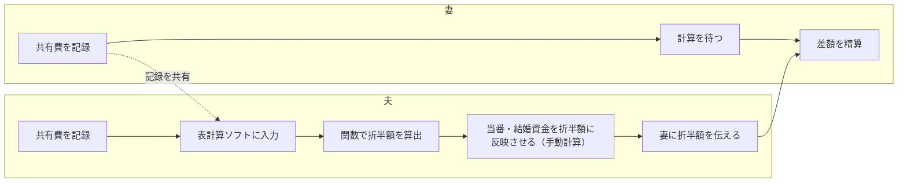
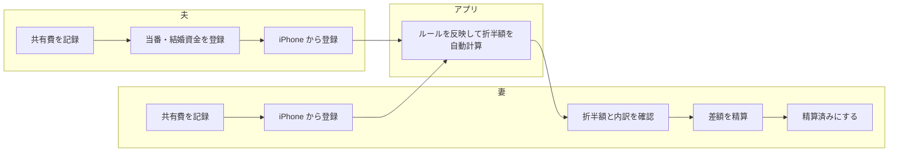

# 要件定義書：SEPANT（折半額計算システム）

| 項目 | 内容 |
|---|---|
| システム名 | SEPANT（折半額計算システム） |
| 作成日 | 2026-10-16 |
| 利用者 | 夫、妻 |

---

## 1. 背景と目的

### 1.1 背景
**現在の家計管理**
- 我が家では夫婦それぞれでお金を管理している。
- 家賃・光熱費等は一度夫が支払い、表計算ソフトで管理して、毎月の折半額を関数で計算している。
- 食費や日用品は各自が気づいたときに購入して金額を記録し、月末に合算して差額を支払いしている。
- 家事の当番制度を導入しており、1ヶ月当番を担当すると、担当した人の折半額が減額され、その分もう一方の負担が増える  
（例：皿洗い当番で±〇〇円、夕食当番で±〇〇円 等）
- 結婚式の資金を積み立てており、毎月一定額を夫の精算額から差し引き、2人分を妻が貯金用の口座に移している。

**課題**
- 上記のルールをすべて手作業で管理・計算しており、手間がかかる。
- 妻からは早く精算したいので計算してほしいと頼まれるが、毎月の複雑な計算が負担となり、数ヶ月分をまとめて計算することが多く、精算が遅れている。
- 表計算ソフトは夫のPCにのみ保存されているため、妻は折半額の根拠を確認できず、計算が不透明になっている。

**システム化を選んだ理由**
- 管理する項目が増えたり金額が変わったりするたびに、セルの追加や計算式の修正が必要になり、表が大きく煩雑になる。
  - 当初は関数を修正して対応していたが、管理の手間が大きくなり、手動計算に戻ってしまった。
- 夫婦共通の口座やクレジットカードを作る案も検討したが、次の理由で見送った。
  - 将来、財布を一つにした際に使わなくなる口座やカードが増える。
  - 口座やカードは、利用がないと手数料や年会費がかかる場合があり、解約忘れによる無駄な出費が発生するリスクがある。
  - 開設・解約や、制度変更への対応の手間がかかる。
- システム化することで、我が家のルールを反映した計算を自動化でき、財布を一つにした後は使うのをやめるだけでよい。

### 1.2 目的
1. 共有費の記録と精算額の計算・確認を、自宅にいるときにスマートフォンからできるようにする。
2. 我が家のルール（家賃補助、当番、結婚資金など）を反映した折半額を自動で算出し、計算の手間とミスを削減する。
3. 夫婦どちらからも同じ内容と計算の根拠を確認できるようにし、精算の透明性を確保する。
4. 妻が自分で精算額を確認できるようにし、毎月の精算の遅れを解消する。

### 1.3 成功の基準
| 指標 | 目標 | 測り方 |
|---|---|---|
| 計算の手間 | 折半額の算出がボタン1つで完了すること | 表計算ソフトでの運用と比較 |
| 精算の遅れ | 毎月計算を急かされることなく精算が完了すること | 運用実績 |
| 移行 | 表計算ソフトを使わずにアプリだけで精算できること | 運用実績 |
| 透明性 | 妻が精算額の内訳と根拠を自分で確認できること | 運用後に妻へヒアリング |
| 満足度 | 夫婦ともに「表計算ソフトより楽」と感じること | 運用後に夫婦でヒアリング |

---

## 2. 利用者

| 利用者 | 主な利用場面 | 端末 |
|---|---|---|
| 夫 | 共有費を登録する、当番を登録する、月末に折半額を確認する | iPhone、PC |
| 妻 | 共有費を登録する、折半額とその根拠を確認し、精算する | iPhone |

---

## 3. 業務フロー

### 3.1 現在（As-Is）


### 3.2 導入後（To-Be）


---

## 4. 機能要件

### 4.1 機能一覧
| ID | 機能 | 概要 | フェーズ |
|---|---|---|---|
| F-01 | 費目管理 | 家賃・電気・ガス・水道などの費目を登録・編集する | 1 |
| F-02 | 支払い登録 | 日付、費目、金額、支払った人を登録する | 1 |
| F-03 | 支払い一覧 | 月ごとの支払いを一覧表示し、編集・削除する | 1 |
| F-04 | 当番登録 | 月ごとに誰がどの当番を担当したかを登録する | 1 |
| F-05 | 精算額の算出 | 4.2 のルールで、各自の支払額と「誰が誰にいくら払うか」を算出する | 1 |
| F-06 | 精算内訳の表示 | 精算額の計算の根拠（費目ごとの合計、控除、調整）を表示する | 1 |
| F-07 | 精算済みの記録 | 精算が終わった月を「精算済」にし、以降は編集できなくする | 1 |
| F-08 | 結婚資金の積立状況 | 結婚資金として積み立てた累計額を表示する | 2 |
| F-09 | 過去データの取り込み | 表計算ソフトの過去データをDBに移行する | 2 |
| F-10 | 定額費の自動登録 | 家賃など毎月同額の費目を、月初に自動で登録する | 3 |
| F-11 | 月別推移 | 費目ごとの金額の推移（光熱費の季節変動など）を表示する | 3 |
| F-12 | ログイン | 夫婦だけがログインできる | 外部公開する場合は実装する |

### 4.2 精算ルール

**費目の区分**
| 費目 | 支払い方 |
|---|---|
| 家賃、電気、ガス、水道、Wi-Fi、NHK、携帯料金 | 主に夫が支払う |
| 食費、日用品 | 各自が購入し、記録する |

**調整項目**（費目ではなく、精算額を増減させるもの）
| 項目 | ルール |
|---|---|
| 家賃補助 | 家賃から差し引いてから折半する |
| 当番控除 | 1ヶ月当番を担当すると、担当した人の負担額が減り、同じ額だけもう一方の負担額が増える（ゼロサム） |
| 結婚資金 | 毎月一定額を夫の精算額から差し引く。差し引いた額は妻が2人分を貯金用口座に移す |

**計算式**
```
共有費合計　　　= 家賃や光熱費（通信費以外） + 合算した食費と日用費（あれば住居手当額を差し引く）
各自の基本負担　= 共有費合計 × 1/2
当番控除　　　　= 担当した人は −当番の金額、もう一方は +当番の金額（合計は0）
各自の負担額　　= 各自の基本負担 + 当番控除
妻の支払額     = 各自の精算額 + 通信費 − 結婚資金（結婚資金分は、妻が貯金用口座に移す）
```
- 負担割合は、全費目で折半（50:50）とする。
- 携帯料金は契約プランが異なるため別途精算する。
- 1円未満の端数は夫が負担する。

### 4.3 主な業務ルール
- 支払いは夫婦どちらが登録したものも両者が閲覧可能とする。
- 精算済みの月の支払いは、誤操作を防ぐため編集・削除できない。
- 金額は1円以上の整数とする。

---

## 5. 非機能要件

| 分類 | 要件 | 備考 |
|---|---|---|
| 対応端末 | Chromeで快適に操作できる（スマートフォン優先の画面） | PCからも利用可 |
| 保守性 | push時にGitHubActionsで単体テストを自動実行する |
| 保守性 | 精算額の計算処理は、単体テストで検証する |
| データ保全 | 月1回以上、DBのバックアップを取得する | PCの故障に備える |
| 費用 | 月額0円で運用する | 自宅 PC で運用 |

### 5.1 セキュリティ要件
自宅LAN内のみで利用するため、ログイン機能を持たせずに、**ネットワークの入口で守る**ことを前提とする。

| ID | 要件 | 理由 |
|---|---|---|
| S-01 | 自宅Wi-Fiの暗号化方式をWPA3にする | Wi-Fiのパスワードを知らない第三者による盗聴を防ぐ |
| S-02 | アプリは自宅でのみ起動し、カフェなどの公共Wi-Fiに接続中は起動しない | 起動中は同じネットワークにいる他人からもアクセスを防ぐ |
| S-03 | DB接続情報などの秘密情報はリポジトリに含めず、環境変数で管理する | GitHub公開時の情報漏洩を防ぐ |
| S-04 | ルーターでポート開放を行わない | Wi-Fiのパスワードを知っている者のみ接続を許可する |

---

## 6. 制約条件

| 項目 | 内容 |
|---|---|
| 言語・FW | HTML + CSS  + Thymeleaf + Java + Spring Boot |
| DB | MySQL |
| 運用環境 | 自宅のPC上で起動し、同じWi-Fiに接続した端末からアクセスする |
| 開発体制 | 1 名（個人開発） |

**運用環境の制約**
- PCのIPアドレスが変わらないよう、ルーターで固定（DHCP予約）する。
- PCが起動していないときは利用できない。
- 外出先からは利用できない。

---

## 7. 対象外（やらないこと）

| 項目 | 理由 |
|---|---|
| 夫婦以外のユーザー登録 | 利用者は2名で固定し、すべての情報を両者が閲覧できればよいため |
| 個人の支出の管理 | まずは共有費の精算に絞る。必要になれば別フェーズで検討する |
| 外部への公開 | 自宅内での利用を想定する。「買い物の直後に入力したい」などの要望が出た場合に検討する |
| 銀行口座・カードとの自動連携 | 認証情報の取り扱いが重く、個人開発の範囲を超えるため |
| ネイティブアプリ化 | Webアプリで要件を満たせるため |
| アプリ内での送金 | 精算の実行は既存の手段で行うため |

---

## 8. フェーズ計画

| フェーズ | 内容 | 完了条件 |
|---|---|---|
| 1 | 支払い・当番の登録と、ルールを反映した精算額の算出 | F-01〜F-08 が動き、1 か月分を実際に精算できる |
| 2 | 過去データの移行 | F-09 が動き、表計算ソフトのデータをアプリで参照できる |
| 3 | 運用を楽にする機能 | F-10、F-11 が動く |
| （随時） | 外部公開への対応 | 外部公開する場合に、F-12 と HTTPS 化を行う |

---

以上