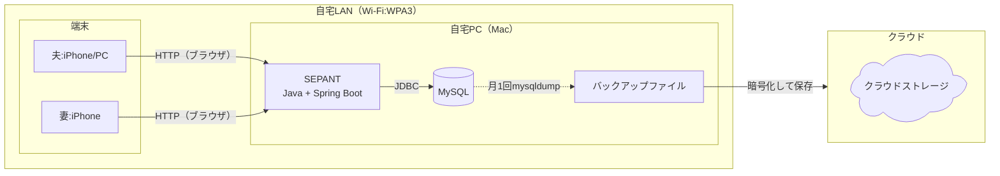
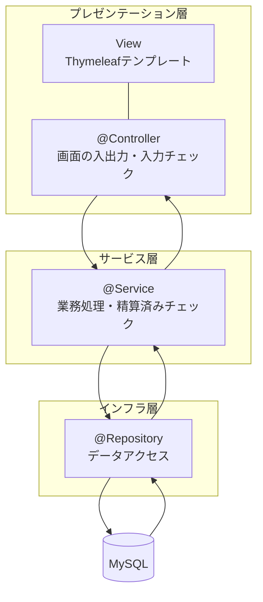
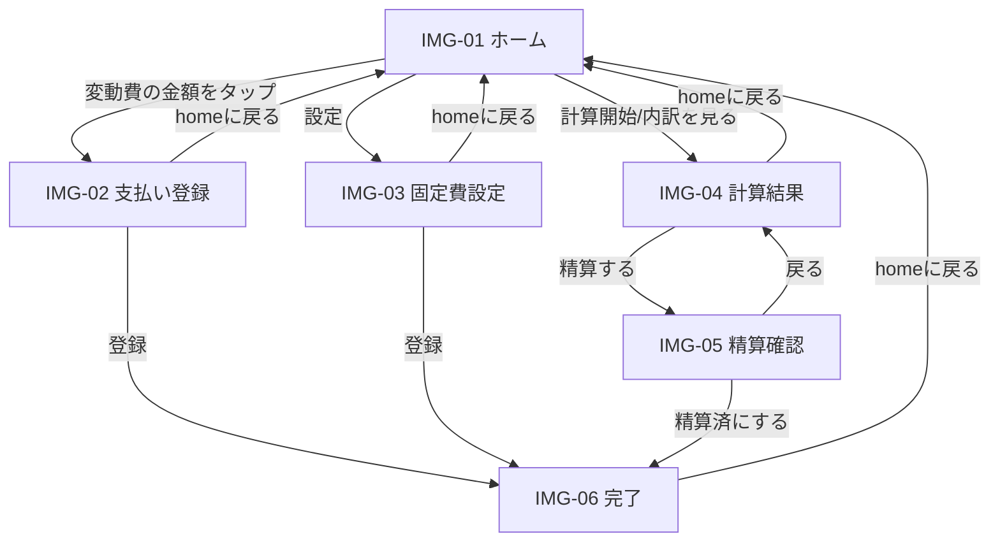
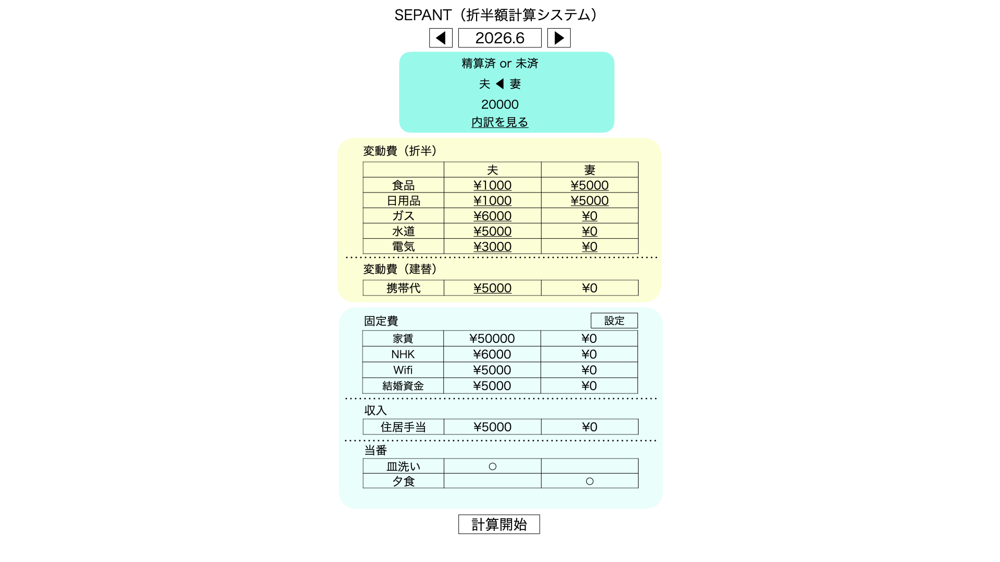
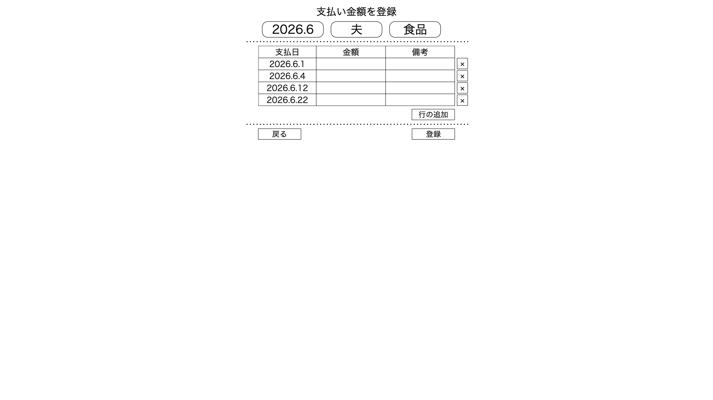
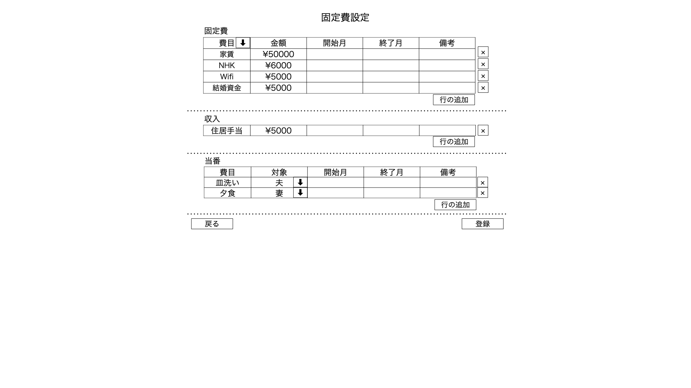
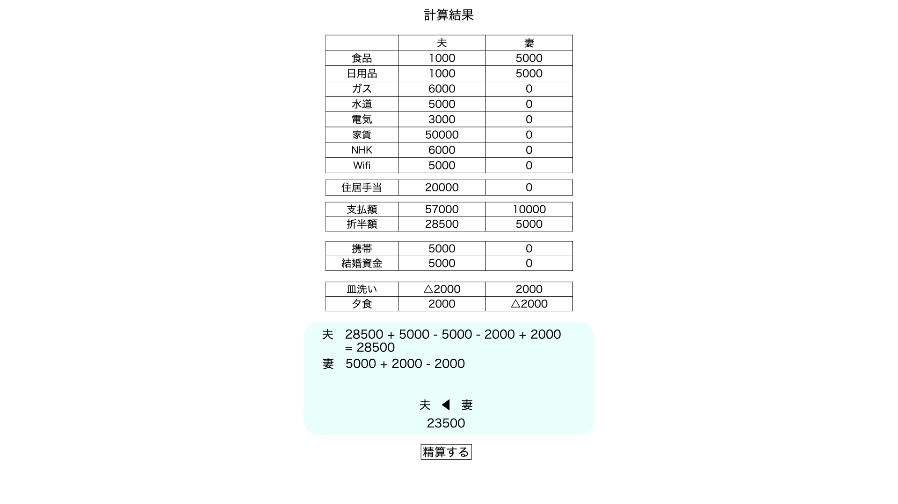
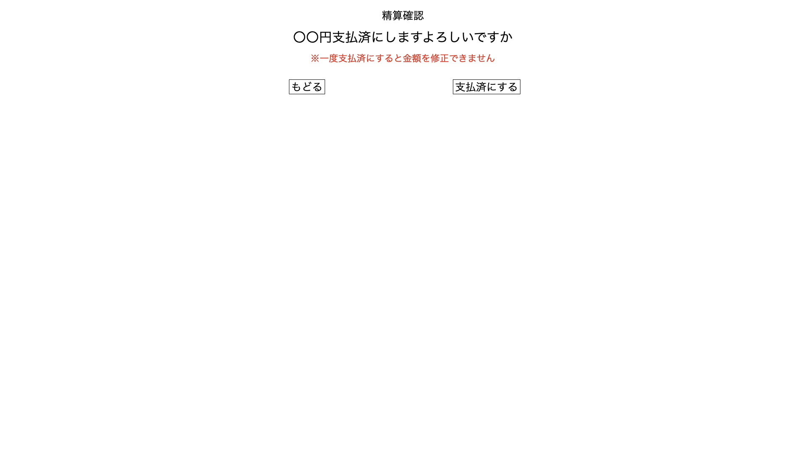
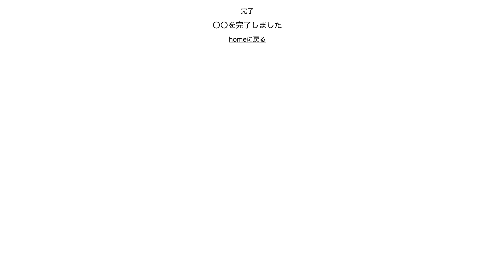

# 基本設計書:SEPANT（折半額計算システム）

| 項目 | 内容 |
|---|---|
| システム名 | SEPANT（折半額計算システム） |
| 対象 | フェーズ1 |
| 作成日 | 2026-10-18 |
| 前提文書 | [要件定義書](../01_要件定義書/要件定義書.md) |

---

## 1. 概要

### 1.1 本書の目的
要件定義書で定めた要件を、どのような構成・画面・データで実現するかを定める。

### 1.2 対象範囲
フェーズ1の機能を対象とする。フェーズ2以降の機能（結婚資金の累計表示など）は、拡張できる構造にすることのみを考慮する。

### 1.3 設計方針
| No | 方針 | 内容 | 理由 |
|---|---|---|---|
| 1 | 構成をシンプルにする | 画面は必要最小限にする。変更頻度の低いマスタ（利用者・費目）は画面を作らず、SQLで更新する。 | 個人開発のため、作る量と保守する量を最小限にし、精算という本来の目的に集中する。 |
| 2 | 操作の手数を少なくする | ボタンの数を減らし、ホームから1タップで目的の画面に移れるようにする。年月・支払った人・費目はホームから引き継ぎ、再入力させない。 | 主な利用場面は、買い物の後や月末にスマートフォンで短時間に操作する場面であるため。 |
| 3 | スマートフォンでの操作を優先する | 画面はスマートフォン幅を基準に設計する。 | 主な利用端末がiPhoneであるため。 |

---

## 2. システム構成

### 2.1 全体構成


### 2.2 技術スタック
| 区分 | 採用技術 | バージョン | 選定理由 |
|---|---|---|---|
| 言語 | Java | 21 | LTS版であり、長く安全に使い続けられる。業務経験とJava Goldで学んだ知識を土台に、最新のJavaに対応した書き方を身につける。 |
| フレームワーク | Spring Boot | 4.1.1 | 業務システムで広く使われているSpringの最新メジャーバージョンである。今回のメイン技術であり、動画教材で学んだ内容のアウトプットとする。 |
| 画面 | Thymeleaf + HTML + CSS | — | Spring Bootが標準で対応しているテンプレートエンジンである。サーバー側で画面を生成するため、JavaScriptを最小限にできる。 |
| DBアクセス | Spring Data JDBC | — | JPAより仕組みが単純で、発行されるSQLを把握しやすい。 |
| DB | MySQL | 9.7.3 | LTS版であり、長く安全に使い続けられる。|
| ビルド | Maven | — | Spring Initializrの標準で、業務でも広く使われている。 |
| テスト | JUnit 6 | — | Spring Boot 4のテスト用スターター（spring-boot-starter-test）に含まれる。 |
| CI | GitHub Actions | — | リポジトリと同じ場所で、push時に単体テストを自動実行できる。 |

### 2.3 ソフトウェア構成（レイヤー）

| レイヤー | 構成要素 | 役割 |
|---|---|---|
| プレゼンテーション層 | @Controller, View | リクエストを受け取り、入力チェックをしてサービス層を呼ぶ。Thymeleafテンプレートで画面を生成する。 |
| サービス層 | @Service | 業務ルールを実行する。 |
| インフラ層 | @Repository | DBの読み書きを行う。 |

---

## 3. 画面設計

### 3.1 画面一覧
| 画面ID | 画面名 | 概要 | 画面イメージ |
|---|---|---|---|
| IMG-01 | ホーム | 対象月の精算見込み、費目ごとの支払い、固定費・当番を表示する。 | `img-01_home.png` |
| IMG-02 | 支払い登録 | 年月・支払った人・費目を指定して、明細を追加・削除する。 | `img-02_payment.png` |
| IMG-03 | 固定費設定 | 固定費・住居手当・結婚資金・当番を期間付きで設定する。 | `img-03_cost.png` |
| IMG-04 | 計算結果 | 精算額と計算の内訳を表示する。 | `img-04_result.png` |
| IMG-05 | 精算確認 | 精算済みにしてよいかを確認する。 | `img-05_confirm.png` |
| IMG-06 | 完了 | 登録・精算の完了を表示する（共通画面）。 | `img-06_complete.png` |

- 画面イメージは`docs/02_基本設計書/images/`に置く。
- 画面イメージは画面の構成を示すものであり、金額はダミーである。計算の詳細は詳細設計で定める。
- 利用者・費目のマスタには画面を作らない（SQLで直接更新する）。

### 3.2 画面遷移

- 登録・精算は、保存後に完了画面へリダイレクトする（PRGパターン。再読み込みによる二重登録を防ぐ）。
- 対象月はホームの◀▶ボタンで切り替え、各画面に引き継ぐ。

### 3.3 画面ごとの設計

#### IMG-01 ホーム


| 領域 | 表示内容 | 操作 |
|---|---|---|
| ヘッダー | 対象月（西暦表示:`2026.6`） | ◀▶で前月・翌月に切り替える。 |
| サマリー | 精算状況（未精算/精算済）、精算の向き（妻→夫は「夫◀妻」、夫→妻は「夫▶妻」）、精算額 | 「内訳を見る」→IMG-04（「精算する」ボタンは非表示） |
| 変動費（折半） | 費目×支払った人の合計金額 | 金額をタップ→IMG-02（年月・人・費目を引き継ぐ） |
| 変動費（立替） | 携帯代など、相手の分を立て替えた金額 | 金額をタップ→IMG-02（年月・人・費目を引き継ぐ） |
| 固定費 | 固定設定から求めた対象月の金額（家賃、NHK、Wi-Fi、結婚資金） | 「設定」→IMG-03 |
| 収入 | 住居手当などの共通の収入 | — |
| 当番 | 当番ごとの担当者 | — |
| フッター | 「計算開始」ボタン | →IMG-04 |

- 明細がないセルは「¥0」と表示し、タップできることを示す。
- 費目の行は、明細がなくても費目マスタの表示順で全て表示する。
- 対象月に有効な固定設定がない当番・固定費がある場合は、「担当（金額）が未設定です」と警告を表示する（期間の切れ目に気付けるようにするため）。
- 精算済みの月は、金額のタップ・計算開始を無効にする。
  - ※フェーズ2で対応してもよい。実装が容易であればフェーズ1で対応する。

#### IMG-02 支払い登録


ホームでタップしたセルの「年月・支払った人・費目」の明細を表示し、追加・削除する。

| 項目 | 入力方法 | 必須 | 入力チェック |
|---|---|---|---|
| 年月・支払った人・費目 | ホームから引き継ぎ、画面上部に表示する（ボタンではなく表示のみ）。 | ○ | 精算済みの月でないこと |
| 支払日 | 日付選択（iPhoneの標準の日付入力） | ○ | 対象月の日付のみ |
| 金額 | 数値キーボード | ○ | 1円以上の整数 |
| 備考 | テキスト | — | 50文字以内 |

- 「行の追加」で入力行を増やし、「×」で行を消す。
- 「登録」で、そのセル（年月・人・費目）の明細をまとめて置き換える（全削除・全登録。1トランザクションで行う）。
- 入力エラーがあるときは、入力内容を残したまま画面を再表示し、表と「行の追加」ボタンの間にエラーメッセージを表示する。
- 夫婦が同じセルを同時に編集した場合は、後から登録した内容が残る（2名での利用のため許容し、対応の優先度は低くする）。

#### IMG-03 固定費設定


| セクション | 項目 | 入力方法 | 必須 | 入力チェック |
|---|---|---|---|---|
| 固定費 | 費目 | プルダウン（区分が折半・立替の費目） | ○ | 期間の重複なし（※） |
| | 支払った人 | プルダウン（夫/妻） | ○ | — |
| | 金額 | 数値キーボード | ○ | 1円以上の整数 |
| | 開始月 | 年月選択 | ○ | — |
| | 終了月 | 年月選択 | ○ | 開始月以降 |
| | 備考 | テキスト | — | — |
| 収入 | 費目 | プルダウン（区分が収入の費目） | ○ | 期間の重複なし（※） |
| | 受け取る人 | プルダウン（夫/妻） | ○ | — |
| | 金額 | 数値キーボード | ○ | 1円以上の整数 |
| | 開始月 | 年月選択 | ○ | — |
| | 終了月 | 年月選択 | ○ | 開始月以降 |
| | 備考 | テキスト | — | — |
| 当番 | 費目 | プルダウン（区分が当番の費目） | ○ | 期間の重複なし（※） |
| | 担当者 | プルダウン（夫/妻） | ○ | — |
| | 金額 | 数値キーボード | ○ | 1円以上の整数 |
| | 開始月 | 年月選択 | ○ | — |
| | 終了月 | 年月選択 | ○ | 開始月以降 |
| | 備考 | テキスト | — | — |

- ※期間の重複:同じ費目で、期間が重なる行は登録できない。
- 「登録」で、全セクションの内容をまとめて保存する（既存の固定設定を全て削除し、画面の内容を新規に登録する。1トランザクションで行う）。
- 当番は毎月、必ず夫か妻のどちらかが担当する（「担当なし」はない）。
- 特定の月だけ金額を変える場合は、期間を分けて行を登録する（例:1~5月50,000、6月~55,000）。
- 固定設定は精算済みの月にも影響するため、精算後は変更しない運用とする（5.5参照）。

#### IMG-04 計算結果


| 領域 | 表示内容 | 操作 |
|---|---|---|
| 支払いの一覧 | 費目×支払った人の金額（固定費を含む） | — |
| 合計 | 各自の支払額、折半額 | — |
| 調整 | 住居手当、当番、携帯代（立替）、結婚資金（立替） | — |
| 結果 | 計算式と、精算の向き・精算額 | — |
| フッター | 「精算する」ボタン | →IMG-05 |

- 計算の内訳は、詳細設計で定める計算順と同じ順番で表示する。
- 精算済みの月は、「精算する」を表示しない。

#### IMG-05 精算確認


- 「○○円精算済にします。よろしいですか」と、精算額を表示する。
- 精算済にすると金額を修正できないことを、注意書きとして表示する。
- 「精算済にする」で精算テーブルに対象年月を登録し、IMG-06へ移る。

#### IMG-06 完了


- 支払い登録・固定費設定・精算の完了時に共通で使う。
- 「○○」には、完了した処理名（支払いの登録/固定費の設定/精算）を表示する。

### 3.4 画面共通の方針
| 項目 | 方針 |
|---|---|
| レイアウト | スマートフォン幅を基準にし、PCでは中央寄せで表示する。 |
| 年月の表示 | 西暦（`2026.6`）で表示する。DBには西暦で保存する。 |
| 金額表示 | 3桁ごとにカンマで区切る。プラスは符号なし、マイナスは△を付ける。 |
| エラー表示 | 入力項目の近くに、赤字でメッセージを表示する。 |

---

## 4. 機能設計

### 4.1 機能と画面の対応
| 機能ID | 機能 | 画面 | 主な処理 |
|---|---|---|---|
| F-01 | 費目管理 | （なし） | SQLで費目マスタを更新する。 |
| F-02 | 支払い登録 | IMG-02 | セル単位で明細を置き換える。 |
| F-03 | 支払い一覧 | IMG-01、IMG-02 | ホームで費目ごとの合計、支払い登録で明細を表示する。 |
| F-04 | 固定設定登録 | IMG-03 | 固定費・収入・当番の固定設定（期間付き）を登録する。 |
| F-05 | 精算額の算出 | IMG-01、IMG-04 | 精算額を計算する。 |
| F-06 | 精算内訳の表示 | IMG-04 | 計算過程を表示する。 |
| F-07 | 精算済みの記録 | IMG-05、IMG-06 | 精算済みの年月を記録し、月を確定する。 |

---

## 5. データ設計

### 5.1 ER図
```
m_user ─┬─< t_hendohi_meisai >─┬─ m_himoku
        └─< t_kotei_settei >───┘

t_seisan ─ 単独
```
※ `─<` は1対多を表す。

### 5.2 テーブル一覧
| No | テーブル名 | 論理名 | 種別 | 内容 |
|---|---|---|---|---|
| 1 | m_user | 利用者 | マスタ | 夫・妻の2名 |
| 2 | m_himoku | 費目 | マスタ | 費目と区分（折半/立替/収入/当番）、表示順 |
| 3 | t_hendohi_meisai | 変動費明細 | トランザクション | 月ごとに支払った変動費の明細 |
| 4 | t_kotei_settei | 固定設定 | トランザクション | 期間ごとの固定費・収入・当番の金額と対象者 |
| 5 | t_seisan | 精算 | トランザクション | 精算済みの年月 |

### 5.3 テーブル定義

#### m_user（利用者）
| 項目名 | カラム名 | PK | FK | 必須 | 備考 |
|---|---|---|---|---|---|
| 利用者ID | user_id | ○ | | ○ | |
| 利用者名 | user_name | | | ○ | 夫/妻 |

#### m_himoku（費目）
| 項目名 | カラム名 | PK | FK | 必須 | 備考 |
|---|---|---|---|---|---|
| 費目CD | himoku_cd | ○ | | ○ | |
| 費目名 | himoku_name | | | ○ | |
| 区分 | kubun | | | ○ | 折半/立替/収入/当番（5.4参照） |
| 表示順 | hyoji_jun | | | ○ | 画面の行の並び順 |

#### t_hendohi_meisai（変動費明細）
| 項目名 | カラム名 | PK | FK | 必須 | 備考 |
|---|---|---|---|---|---|
| 明細ID | meisai_id | ○ | | ○ | |
| 対象年月 | taisho_yymm | | | ○ | 西暦 |
| 支払者 | user_id | | m_user | ○ | |
| 費目CD | himoku_cd | | m_himoku | ○ | 区分が折半・立替の費目のみ |
| 支払日 | shiharai_dd | | | ○ | 対象年月の日付 |
| 金額 | kingaku | | | ○ | 1円以上の整数 |
| 備考 | biko | | | | 50文字以内 |

#### t_kotei_settei（固定設定）
| 項目名 | カラム名 | PK | FK | 必須 | 備考 |
|---|---|---|---|---|---|
| 設定ID | settei_id | ○ | | ○ | |
| 費目CD | himoku_cd | | m_himoku | ○ | 区分で固定費・収入・当番を判別する。 |
| 利用者ID | user_id | | m_user | ○ | 固定費は支払う人、収入は受け取る人、当番は担当者 |
| 金額 | kingaku | | | ○ | 1円以上の整数。1か月あたりの金額 |
| 開始月 | kaishi_mm | | | ○ | 西暦 |
| 終了月 | shuryo_mm | | | ○ | 開始月以降 |
| 備考 | biko | | | | |

#### t_seisan（精算）
| 項目名 | カラム名 | PK | FK | 必須 | 備考 |
|---|---|---|---|---|---|
| 対象年月 | taisho_yymm | ○ | | ○ | 西暦。行があれば精算済み |
| 精算日 | seisan_dd | | | ○ | 精算済にした日 |

### 5.4 コード値
| 項目 | 値 | 意味 | 費目の例 | 使うテーブル |
|---|---|---|---|---|
| 区分（kubun） | 折半 | 2人で折半する支出 | 食費、日用品、家賃 | 変動費明細、固定設定 |
| | 立替 | 相手の分を立て替えた支出 | 携帯代、結婚資金 | 変動費明細、固定設定 |
| | 収入 | 負担額から差し引く収入 | 住居手当 | 固定設定 |
| | 当番 | 担当者の負担額を調整する当番 | 皿洗い、夕食 | 固定設定 |

- 固定設定は、同じ費目で期間が重なる行を持たない。

---

以上